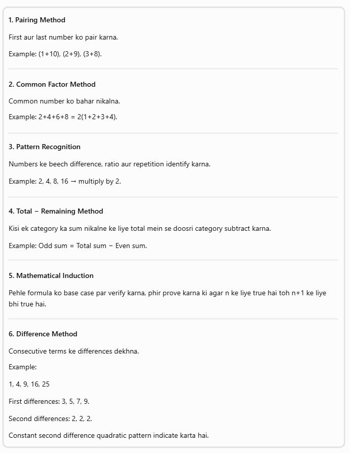
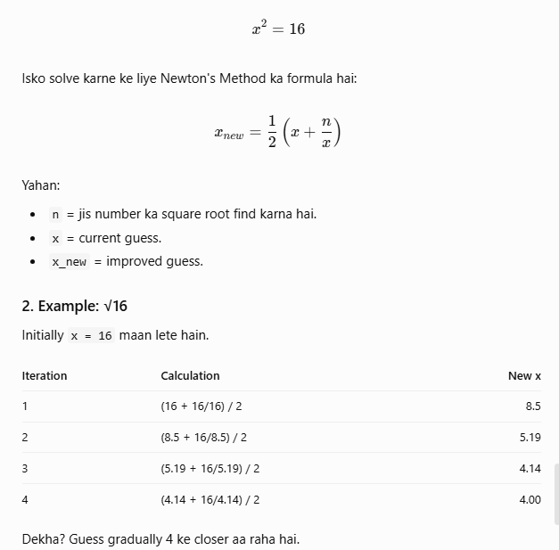

# DAY 1 
SIMPLE NO. PROBLEMS

## about no. series how we can solve a problem with constant time complexity (genral thought process) , way to buid it 
given no.śereis sai kesa ek formula get kr skta hai in terms of n so we can calcute the result within the contant time complexity
[alt text](/images/image2.png)

Formula derive karne ke liye kaun-kaun si techniques seekhni hain?
Ye sabse important section hai. Tumhara focus sirf formulas collect karna nahi, balki khud formulas derive karna hona chahiye.

Tum jab bhi koi mathematical problem solve karo, toh directly formula search mat karna.

Khud se ye questions poochna:
1. Given numbers ka pattern kya hai?
2. Kya numbers ko pair ya group kar sakte hain?
3. Kya koi common factor nikal sakte hain?
4. Total terms kitni hain?
5. Kya kisi known series ka formula apply ho sakta hai?
6. Kya formula ko n ki general form mein likh sakte hain?
7. Kya even aur odd cases mein alag handling chahiye?
8. Kya isse loop ki jagah O(1) mein solve kar sakte hain?
Meri advice: Har problem ke liye ek notebook maintain karo jisme 4 cheezein likho: Given → Pattern → Derivation → General Formula.

## about big init 

## way to know about the perfect square and Rs method (during home assigement)
1. about perfect square logic
- way 1
 for (let j = 1; j <= i; j++) {
        if (j * j === i) {
          console.log(i);
          break;
        }
      }

- way 2 (Newton's Method (Newton-Raphson Method))

Newton's Method ek numerical technique hai, jiska use kisi number ya equation ka approximate root find karne ke liye kiya jata hai.

1. Initially ek guess (x) assume karte hain ki square root kya ho sakta hai.
2. Formula apply karke guess ko improve karte hain.
3. Har iteration mein guess actual square root ke closer hota jata hai.
4. Ye process accurate result milne tak repeat hota hai.
5. Perfect Square check karne ke liye square root ka square original number se compare karte hain.

`Important`: Newton's Method mein bhi iterations ke liye loop chahiye. Isliye tumhari original condition ke liye agar strictly ek hi loop allowed hai, toh Newton's Method directly suitable nahi hai.
`Remember`: Newton's Method mein hum repeatedly apne initial guess ko improve karte hain, taaki actual answer ke closer pahunch sakein.

